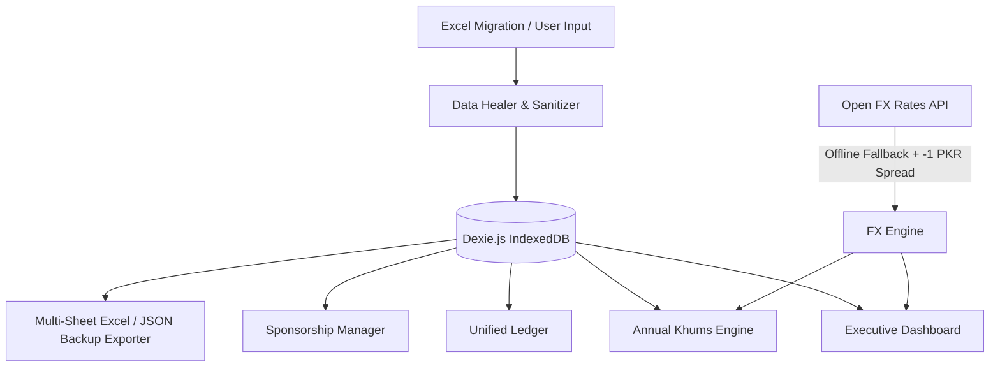

# Sada Hisab (سادہ حساب)
### Multi-Currency Cash Management, Sponsorships & Annual Khums Accounting

> **Production-grade, 100% local-first, privacy-focused financial accounting web & mobile application designed for cross-border personal wealth, student sponsorships, and Islamic Khums calculations.**

---

## 🌟 Executive Summary

**Sada Hisab** replaces fragile legacy spreadsheets with a resilient, reactive, local-first accounting system. It is engineered specifically for individuals managing multi-currency personal finances across **Pakistan (`PKR`)**, the **UAE (`AED`)**, and global remote platforms (**USD**, **GBP**, **SAR**, **MYR**, **IQD**), featuring:

1. **Annual Islamic Khums Engine (November 30 Cutoff):** Automated audit calculation conforming strictly to classical Ja'fari fiqh rules—deducting prior purified capital, excluding family custodial amanat, and factoring loan receivables.
2. **Legacy Excel Healer:** Ingests legacy spreadsheets (such as `Khums - November 30 2025 - Daily.xlsx`) and automatically repairs string amount prefixes (`dh 63.11`, `dn 470.27`), shifted columns, missing chronological dates, and the infamous Excel row-66 formula truncation bug.
3. **Monthly Sponsorships & Charity Manager:** Automated tracking of recurring student tuition fees (Mustafa, Fatima FBIS), Maulana honorariums, and orphan welfare with 1-click ledger logging.
4. **100% Local-First & Air-Gapped:** All data resides in client-side IndexedDB (`Dexie.js`). Zero servers, zero telemetry, zero privacy leakage.
5. **Multi-Platform Deployment:** Ready as a Progressive Web App (PWA), Android App (via Capacitor / TWA), and desktop web app.

---

## 🏛️ System Architecture



### Pre-Configured Accounts
- **Pakistan Banks:** `Al Habib - Rs (PKR)`, `Al Habib - Do (USD)`, `Al Habib - Po (GBP)`, `HBL (PKR)`, `SCB (PKR)`
- **UAE Banking:** `ADCB (AED)`
- **Digital Wallets:** `Wise (USD)`, `Paypal (USD)`, `Payoneer (USD)`, `Remote Pass (USD)`, `Infini (PKR)`, `Nayapay (PKR)`, `Easypaisa (PKR)`, `JazzCash (PKR)`, `Daraz Wallet (PKR)`
- **Physical Cash & Bonds:** `Cash in Wallet (PKR)`, `Petty Cash (PKR)`, `200Rs Bond (PKR)`, `Currency at Home (USD/GBP/SAR/AED/MYR/IQD)`
- **Custodial / Amanat (Excluded from Khums):** `Cupboard - Children Galla (PKR)`, `Wife Savings & Amanat (PKR)`
- **Liabilities:** `Credit Card (PKR/AED)`

---

## 📜 Islamic Khums Calculation Methodology (Nov 30)

Khums is an obligatory annual 20% levy on net annual surplus savings. Sada Hisab implements the canonical mathematical formula:

$$\text{Net Khumsable Surplus} = (S + C_{20\%} + I_{25\%} + R) - (A_{\text{custodial}} + L_{\text{CC}} + K_{\text{prior}})$$

Where:
- $S$: Total liquid savings across all operational bank accounts and foreign cash holdings converted to PKR at conservative rates.
- $C_{20\%}$: Remaining value of unused consumables (groceries, perfumes, toiletries) on November 30.
- $I_{25\%}$: Unused new goods, unworn clothing, and unopened electronics acquired during the year.
- $R$: Active loan receivables given to others (e.g., the Rs. 328,369 family loan receivable—taxable because it is expected back).
- $A_{\text{custodial}}$: Excluded custodial funds (Wife's personal wealth, Children Galla, Hajj savings).
- $L_{\text{CC}}$: Pending credit card debt and unpaid short-term liabilities (deducted).
- $K_{\text{prior}}$: **Prior Year Purified Capital** (net wealth on which Khums was already paid in previous Nov 30 snapshots—deducted to prevent double taxation).

$$\text{Khums Payable (20\%)} = \max(0, \text{Net Khumsable Surplus} \times 0.20) + \text{Voluntary Buffer}$$

The resulting sum is divided into:
- **Sahm-e-Imam (10%):** Disbursed according to Marja' authorization for religious and community welfare.
- **Sahm-e-Sadat (10%):** Allocated for needy descendants of the Prophet (Banu Hashim).

---

## 🩹 Excel Data Healer & Repair Engine

| Issue in Legacy Excel | Symptom / Raw String | Automated Healing Applied | Status |
| :--- | :--- | :--- | :--- |
| **String Amount Bug** | `"dh 63.11"`, `"dn 470.27"`, `"dn 65"` | Strips prefix, parses clean float, sets currency to `AED` | `AUTO_HEALED` |
| **Shifted Column Bug** | Currency is blank, Income Source contains `"PKR"` | Restores `"PKR"` to Currency, reassigns default account | `AUTO_HEALED` |
| **Numeric Source Cell** | Source cell contains `"2700"`, `"2850"` | Preserves numeric value in `lastMonthReferenceAmount`, restores account | `AUTO_HEALED` |
| **Missing / Placeholder Dates** | Date is `"-"`, `"?"`, or empty | Infers chronological date from adjacent rows, flags for 1-click review | `FLAGGED_REVIEW` |
| **Multiline Spent At** | Multiline text containing mobile numbers | Regex extracts Pakistani mobile (`03\d{9}`) & channel (`Easypaisa`) | `AUTO_HEALED` |
| **Row-66 Truncation** | Excel `=SUM(...)` stopped at row 66 | Recalculates full history across 700+ rows, displays reconciliation card | `100% RECOVERED` |

---

## 🚀 Getting Started

### Prerequisites
- Node.js 18+ (tested on Node v20)
- npm or yarn

### Installation & Local Run
```bash
# Navigate to the project directory
cd sada-hisab

# Install dependencies
npm install

# Start local development server
npm run dev
```

Open your browser at `http://localhost:3000`.

### Production Build
```bash
npm run build
npm run preview
```

---

## 📱 Android App & PWA Installation

### 1. Progressive Web App (PWA)
- On Chrome / Edge: Click the **Install** button in the URL bar.
- On Safari iOS / Chrome Android: Select **Share &rarr; Add to Home Screen**.
- Works 100% offline via the included Service Worker (`/sw.js`).

### 2. Android Standalone APK (Capacitor)
```bash
# Install Capacitor CLI & Android platform
npm install @capacitor/core @capacitor/cli @capacitor/android

# Initialize Android native project
npx cap add android

# Build web assets and sync to native Android
npm run build
npx cap sync

# Open in Android Studio to build APK or run on connected device
npx cap open android
```

---

## 🔒 Privacy & Local-First Philosophy
- **No Remote Database:** All accounts, transactions, and snapshots exist solely in your device's browser IndexedDB.
- **Offline Capable:** Offline fallback exchange rates (`USD=276.53`, `AED=75.31`, `SAR=73.68`, etc.) ensure complete independence from external network availability.
- **Portability:** Export your entire ledger back to clean multi-sheet `.xlsx` or complete JSON backup with a single click at any time.

---

&copy; 2026 Sada Hisab. Built with React, TypeScript, Tailwind CSS, Dexie.js & SheetJS.
