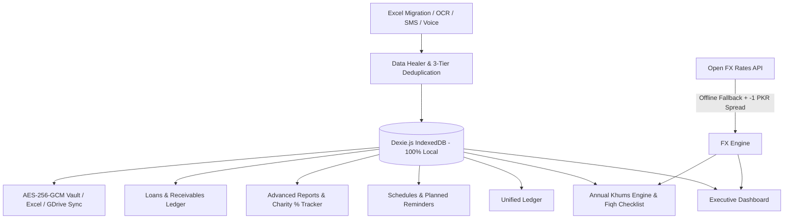

# Sada Hisab (سادہ حساب)
### Multi-Currency Cash Management, Sponsorships & Annual Khums Accounting

> **Production-grade, 100% local-first, privacy-focused financial accounting web & mobile application designed for cross-border personal wealth, student sponsorships, and Islamic Khums calculations.**

---

## 🌟 Executive Summary

**Sada Hisab** replaces fragile legacy spreadsheets with a resilient, reactive, local-first accounting system. It is engineered specifically for individuals managing multi-currency personal finances across **Pakistan (`PKR`)**, the **UAE (`AED`)**, and global remote platforms (**USD**, **GBP**, **SAR**, **MYR**, **IQD**), featuring:

1. **Multimodal Bill, Receipt & PDF Invoice Scanner:**
   - 100% on-device text-layer extraction for digital PDFs (`pdfjs-dist`) and on-device OCR for receipts & photos (`tesseract.js`).
   - Optional Bring-Your-Own-Key (BYOK) Gemini Flash Vision mode stored exclusively in local `localStorage`.
   - Single bill auto-fill vs. multi-row 50+ line bank & card statement tabular staging parser.
2. **Hands-Free Voice Note Expense & Bill Logger:**
   - Powered by Web Speech API (`webkitSpeechRecognition`) supporting natural spoken sentences mixing English, Urdu, and Arabic terms (*"Paid 365.87 AED for DEWA bill from ADCB"*, *"Sent 12,525 rupees to Green Island School from Al Habib"*).
   - Deterministic and fuzzy NLP parser with live interactive card, account suggestions, and a 3-second auto-save countdown.
3. **3-Tier Anti-Duplication & Cross-Channel Reconciliation Engine:**
   - **Tier 1:** Deterministic SHA-256 fingerprint hash (`date:amount:currency:merchant:account`).
   - **Tier 2:** Cross-channel fuzzy collision detector (±2 days window, identical amount/currency or ≤1.5% FX variance) with side-by-side "Merge or Keep Both" interactive card.
   - **Tier 3:** Credit Card & Transfer double-count guard preventing debt payments from inflating expenses.
4. **Planned Schedules, Reminders & iCalendar (.ics) Sync:**
   - Day-of-month tracking (1st–31st) for Family allowances (Wife, Rohia, Children), utilities (StromFiber, M106, Mobile 48 AED), education/transport (Green Island, Asghar Van), and monthly Sadaqah roster.
   - On-device browser notifications and 1-click RFC 5545 `.ics` export for Google Calendar, Apple Calendar, and Outlook.
5. **Yearly Donation & Sadaqah % Calculator:**
   - Live tracking of non-Khums charitable contributions as a percentage of gross annual income.
   - Interactive target % slider (3% to 25%), progress bar, and breakdown across Student Education, Clergy Stipends, and Welfare Trusts.
6. **Advanced Financial Reporting Suite:**
   - Multi-period analysis: Khums Fiscal Year (Dec 1–Nov 30), Calendar Year (Jan 1–Dec 31), or custom date range.
   - Dual-currency base toggle (PKR / AED), visual monthly inflow vs outflow charts, category spending breakdown, clean printable PDF layout (`window.print()`), and multi-tab `.xlsx` download.
7. **Loans & Receivables Ledger, 20% Consumables Checklist & Google Drive Sync:**
   - Dedicated loans given tracking with **Recoverable (In Khums)** vs **Doubtful (Excluded)** toggles.
   - Fiqh checklist for 20% Khums on year-end surplus consumables, pantry reserves, and unused goods.
   - Client-side zero-backend Google Drive OAuth2 sync (`drive.file`) directly to `SadaCash_Backups/` folder.
8. **Zero-Trust Local Security & Cryptographic Vault:**
   - Built-in **App Lock** (PBKDF2 4–6 digit PIN & WebAuthn biometrics for TouchID / Android Fingerprint) with 5-minute inactivity auto-lock.
   - Passphrase-derived **AES-256-GCM encrypted `.khumsvault` backups** alongside unencrypted JSON and multi-tab `.xlsx`.
9. **Zero-Hazard Smart SMS / Receipt Parser ("Magic Inbox"):**
   - Ingests raw banking SMS, WhatsApp receipts, and notification dumps. Protected by a **Hard OTP Security Firewall** that immediately intercepts and scrubs verification codes from memory without writing them to disk.
10. **1-Click Monthly Recurring Roster:**
    - Automatically batches ~25 recurring monthly entries (Green Island School, Asghar Bhai Van, Maulana Qalbe Ali, Khatoon Khatoon, Zaibun Nisa, StromFiber, Wife Monthly Allowance, M106 utilities) with 1-click batch ledger commit.
11. **Annual Islamic Khums Engine (November 30 Cutoff):**
    - Automated audit calculation conforming strictly to classical Ja'fari fiqh rules—deducting prior purified capital, excluding family custodial amanat, and factoring loan receivables.
12. **Legacy Excel Healer:**
    - Ingests legacy spreadsheets (such as `Khums - November 30 2025 - Daily.xlsx`) and automatically repairs string amount prefixes (`dh 63.11`, `dn 470.27`), shifted columns, missing chronological dates, and the infamous Excel row-66 formula truncation bug.

---

## 🧠 Deep Workbook Domain Intelligence & Zero-Touch Autopilot

Built upon a forensic audit of all 731 rows of `Khums - November 30 2025 - Daily.xlsx`, the system incorporates deep domain automation:

### 1. Monthly Block-Aware Excel Importer & Clone Detector
- **Empty-Row Monthly Block Inferencing:** Partitions the `Expense` sheet into 22 chronological monthly blocks (Dec 2024 to Oct 2026), tagging transactions with `billingMonth` (`YYYY-MM`) based on the majority date in each block.
- **Stale Date Healing:** Automatically heals stale copy-pasted utility rows (such as `2026-08-02` UAE utility rows pasted in Sept/Oct blocks in rows 627–631, 664–668, and 701–705), realigning them with their true billing month.
- **Cloned Block Detector & 1-Click Resolver:** Detects accidental copy-paste cloned blocks (**Jan 2025 rows 31–46 vs 49–64** and **Oct 2026 rows 634–668 vs 671–705**). Surfaces a dedicated **Duplicate Monthly Block Resolver banner** in the Importer to discard duplicate blocks in 1 click and eliminate double-counting.
- **Formula Evaluator & Multiplier Notes:** Parses and calculates Excel arithmetic formulas (e.g. `=4500*2` evaluates to 9,000 PKR with `monthsCovered = 2` and formula note `"2 months × 4,500"`).

### 2. Coordinator / Aggregator Auto-Splitter & WhatsApp Dispatcher
- **6 Pre-Configured Coordinator Groups:**
  1. *Maulana Qalbe Ali* (10 students, 36,950 PKR commitment)
  2. *Khatoon Khatoon* (3 students, 11,200 PKR commitment)
  3. *Zaibun Nisa* (4 students, 11,550 PKR commitment)
  4. *Shokat Ali* (2 students, 3,500 PKR commitment)
  5. *Syed Taha-ud-din* (2 students, 7,150 PKR commitment)
  6. *Muhammad Syed* (2 students, 8,000 PKR commitment)
- **1-Tap Transfer + Auto-Split:** Ingests or logs single lump-sum transfers and automatically creates individual child transactions linked by `parentTransferId`.
- **1-Click WhatsApp Formatted Breakdown:** Generates and copies ready-to-send Urdu/English student fee messages directly to the clipboard. Also integrated seamlessly into the **Magic Inbox** whenever an incoming SMS matches a coordinator.

### 3. Prepaid & Multi-Month Advance Tracker (Auto-Skip Engine)
- **Advance Invoicing:** Supports paying school fees, van, or rents 2 or 3 months in advance.
- **Smart Auto-Skip in Monthly Roster:** Automatically sets `prepaidUntilMonth`. During the next month's recurring roster run, prepaid items are auto-toggled OFF with a clear `"Prepaid in [Prior Month] ✅"` indicator.

### 4. "Kemati" (ROSCA / Committee) & Special Asset Accounting
- **Monthly 50,000 PKR Committee Payments:** Treated as a transfer to locked savings / receivable equity, keeping dead consumption expenses accurate.
- **Cash Flow Exclusion Toggle:** Allows analyzing monthly cash flows with or without Kemati savings.
- **Khums Inclusion:** Automatically factors accumulated committee equity into the Annual Nov 30 Khums calculation.
- **Dual-Currency Wife Allowance:** Seamlessly toggles between UAE living expenses (`350 AED`) and Pakistan home visits (`14,000 / 18,000 PKR`).

### 5. Dual FX Rate Modes Switcher
- Accessible from the top navigation bar at all times:
  1. **Conservative Khums Mode (Live - 1 PKR Spread):** Matches the classical Totals sheet formula (`Live - 1 PKR`).
  2. **Live Mid-Market Rate:** Direct open-market rates via `open.er-api.com`.
  3. **Fixed Snapshot Rate:** Manual benchmark rates matching the Income tab (USD=278, AED=75.5, GBP=352).

### 6. Ultra-Low-Friction Home Quick-Actions & Smart Alerts
- **Home Screen Quick-Action Bar:** Instant triggers for `⚡ Run Monthly Roster`, `📋 Paste SMS / WhatsApp`, `🎙️ Hold to Speak`, and `📸 Scan Bill / Receipt`.
- **Smart Utility Variance Alerts:** Flags DEWA, Etisalat, Royal Gas, or StromFiber bills when current charges surge $>15\%$ compared to the previous month's baseline.

---

## 🏛️ System Architecture



### Pre-Configured Accounts
- **Pakistan Banks:** `Al Habib - Rs (PKR)`, `Al Habib - Do (USD)`, `Al Habib - Po (GBP)`, `HBL (PKR)`, `SCB (PKR)`
- **UAE Banking:** `ADCB (AED)`
- **Digital Wallets:** `Wise (USD)`, `Paypal (USD)`, `Payoneer (USD)`, `Remote Pass (USD)`, `Infini (PKR)`, `Nayapay (PKR)`, `Easypaisa (PKR)`, `JazzCash (PKR)`, `Daraz Wallet (PKR)`
- **Physical Cash & Bonds:** `Cash in Wallet (PKR)`, `Petty Cash (PKR)`, `200Rs Bond (PKR)`, `Currency at Home (USD/GBP/SAR/AED/MYR/IQD)`
- **Custodial / Amanat (Excluded from Khums):** `Cupboard - Children Galla (PKR)`, `Wife Savings & Amanat (PKR)`
- **Liabilities:** `Credit Card (PKR/AED)`

---

## 📜 Islamic Khums Calculation Methodology (Nov 30)

Khums is an obligatory annual 20% levy on net annual surplus savings. Sada Hisab implements the canonical mathematical formula:

$$\text{Net Khumsable Surplus} = (S + C_{20\%} + I_{25\%} + R) - (A_{\text{custodial}} + L_{\text{CC}} + K_{\text{prior}})$$

Where:
- $S$: Total liquid savings across all operational bank accounts and foreign cash holdings converted to PKR at conservative rates.
- $C_{20\%}$: Remaining value of unused consumables (groceries, perfumes, toiletries) on November 30.
- $I_{25\%}$: Unused new goods, unworn clothing, and unopened electronics acquired during the year.
- $R$: Active recoverable loan receivables given to others (e.g., the Rs. 328,369 family loan receivable—taxable because it is expected back).
- $A_{\text{custodial}}$: Excluded custodial funds (Wife's personal wealth, Children Galla, Hajj savings).
- $L_{\text{CC}}$: Pending credit card debt and unpaid short-term liabilities (deducted).
- $K_{\text{prior}}$: **Prior Year Purified Capital** (net wealth on which Khums was already paid in previous Nov 30 snapshots—deducted to prevent double taxation).

$$\text{Khums Payable (20\%)} = \max(0, \text{Net Khumsable Surplus} \times 0.20) + \text{Voluntary Buffer}$$

The resulting sum is divided into:
- **Sahm-e-Imam (10%):** Disbursed according to Marja' authorization for religious and community welfare.
- **Sahm-e-Sadat (10%):** Allocated for needy descendants of the Prophet (Banu Hashim).

---

## 🩹 Excel Data Healer & Repair Engine

| Issue in Legacy Excel | Symptom / Raw String | Automated Healing Applied | Status |
| :--- | :--- | :--- | :--- |
| **String Amount Bug** | `"dh 63.11"`, `"dn 470.27"`, `"dn 65"` | Strips prefix, parses clean float, sets currency to `AED` | `AUTO_HEALED` |
| **Shifted Column Bug** | Currency is blank, Income Source contains `"PKR"` | Restores `"PKR"` to Currency, reassigns default account | `AUTO_HEALED` |
| **Numeric Source Cell** | Source cell contains `"2700"`, `"2850"` | Preserves numeric value in `lastMonthReferenceAmount`, restores account | `AUTO_HEALED` |
| **Missing / Placeholder Dates** | Date is `"-"`, `"?"`, or empty | Infers chronological date from adjacent rows, flags for 1-click review | `FLAGGED_REVIEW` |
| **Multiline Spent At** | Multiline text containing mobile numbers | Regex extracts Pakistani mobile (`03\d{9}`) & channel (`Easypaisa`) | `AUTO_HEALED` |
| **Row-66 Truncation** | Excel `=SUM(...)` stopped at row 66 | Recalculates full history across 700+ rows, displays reconciliation card | `100% RECOVERED` |

---

## 🚀 Getting Started

### Prerequisites
- Node.js 18+ (tested on Node v20)
- npm or yarn

### Installation & Local Run
```bash
# Navigate to the project directory
cd sada-hisab

# Install dependencies
npm install

# Start local development server
npm run dev
```

Open your browser at `http://localhost:3000`.

### Production Build
```bash
npm run build
npm run preview
```

---

## 📱 Android App & PWA Installation

### 1. Progressive Web App (PWA)
- On Chrome / Edge: Click the **Install** button in the URL bar.
- On Safari iOS / Chrome Android: Select **Share &rarr; Add to Home Screen**.
- Works 100% offline via the included Service Worker (`/sw.js`).

### 2. Android Standalone APK (Capacitor)
```bash
# Install Capacitor CLI & Android platform
npm install @capacitor/core @capacitor/cli @capacitor/android

# Initialize Android native project
npx cap add android

# Build web assets and sync to native Android
npm run build
npx cap sync

# Open in Android Studio to build APK or run on connected device
npx cap open android
```

---

## 🔒 Privacy & Local-First Philosophy
- **No Remote Database:** All accounts, transactions, and snapshots exist solely in your device's browser IndexedDB.
- **Offline Capable:** Offline fallback exchange rates (`USD=276.53`, `AED=75.31`, `SAR=73.68`, etc.) ensure complete independence from external network availability.
- **Client-Side Zero-Backend Cloud Sync:** Optional Google Drive backup uploads encrypted snapshots directly via browser OAuth2 without touching any third-party intermediate server.
- **Portability:** Export your entire ledger back to clean multi-sheet `.xlsx` or complete JSON backup with a single click at any time.

---

&copy; 2026 Sada Hisab. Built with React, TypeScript, Tailwind CSS, Dexie.js & SheetJS.
